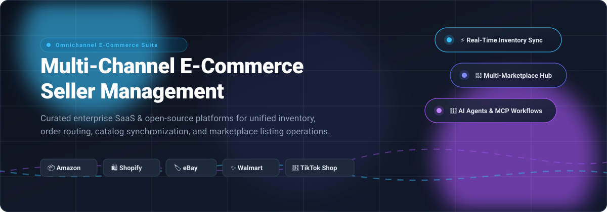

# 🛒 Awesome Multi-Channel E-Commerce Seller Management 🚀

<p align="center">
  <a href="https://github.com/ishandutta2007/Awesome-Multi-Channel-E-Commerce-Seller-Management">
    
  </a>
</p>

<p align="center">
  <strong>A curated index of top-tier multi-channel e-commerce seller management systems, enterprise order management software (OMS), marketplace integration engines, and self-hosted open-source inventory platforms.</strong>
</p>

<p align="center">
  <a href="https://github.com/ishandutta2007/Awesome-Multi-Channel-E-Commerce-Seller-Management/stargazers"></a>
  <a href="https://github.com/ishandutta2007/Awesome-Multi-Channel-E-Commerce-Seller-Management/network/members"></a>
  <a href="https://github.com/ishandutta2007/Awesome-Multi-Channel-E-Commerce-Seller-Management/blob/main/LICENSE"></a>
  <a href="https://github.com/sindresorhus/awesome"></a>
  <a href="https://github.com/ishandutta2007/Awesome-Multi-Channel-E-Commerce-Seller-Management/pulls"></a>
</p>

> 🌟 **Star this repository** if you find it helpful for scaling your multi-channel seller operations and cross-marketplace integrations! 🌟

---

## 🧭 Table of Contents

- [📈 Sector Overview & Market Dynamics](#-sector-overview--market-dynamics)
- [🟦 SaaS & Commercial Hosted Platforms](#-saas--commercial-hosted-platforms)
  - [Enterprise SaaS Comparison Table](#-enterprise-saas-comparison-table)
  - [Detailed SaaS Platform Breakdown](#-detailed-saas-platform-breakdown)
- [🟩 Open-Source & Self-Hosted Software](#-open-source--self-hosted-software)
  - [Open-Source Solutions Ranked by Stars](#-open-source-solutions-ranked-by-stars)
  - [Detailed Open-Source Project Breakdown](#-detailed-open-source-project-breakdown)
- [📊 Feature & Architectural Matrix](#-feature--architectural-matrix)
- [💡 Choosing the Right Platform](#-choosing-the-right-platform)
- [🤝 Contributing](#-contributing)
- [📄 License](#-license)

---

## 📈 Sector Overview & Market Dynamics

The global **Multi-Channel E-Commerce Seller Management and Order Management System (OMS)** software sector is estimated at **$2.3B to $2.5B**, expanding at a 6.8%–11.5% CAGR toward **$4B+ to $6B+** as merchants diversify listings across Amazon, Walmart, Shopify, TikTok Shop, eBay, and regional marketplaces.

The market structure is **highly fragmented** across SMB, mid-market, and enterprise tiers rather than a "winner-take-all" monopoly, driven by localized marketplace APIs (Shopee/Lazada in APAC, Mercado Libre in LATAM), varying catalog complexities, and specialized merchant demands spanning real-time inventory buffering, dropship EDI routing, and warehouse automation.

---

## 🟦 SaaS & Commercial Hosted Platforms

Commercial, cloud-hosted multi-channel e-commerce management platforms provide out-of-the-box connectors to major marketplaces, automated feed syndication, carrier routing, and continuous API compliance.

### 🏢 Enterprise SaaS Comparison Table

*The table below is sorted by **Company Scale / Valuation (Descending)**:*

| Platform 🏷️ | Scale / Valuation 💰 | Starting Pricing 💳 | Free Tier / Trial Limits ⏱️ | Target Market 🎯 | Key Marketplaces 🌐 |
| :--- | :--- | :--- | :--- | :--- | :--- |
| **[Sellbrite (GoDaddy)](#sellbrite-godaddy-)** | **$21B+ Market Cap** (GoDaddy NYSE: GDDY parent; acquired Sellbrite) | **$29/mo** (Pro 100 tier for up to 100 orders/mo) | **Forever-free plan** (up to 30 orders/mo, standard sync, no FBA/API); plus **14-day free trial** with unlimited features (no credit card required) | SMB & growing multi-channel merchants | Amazon, eBay, Walmart, Etsy, Shopify, BigCommerce |
| **[ChannelAdvisor (Rithum)](#channeladvisor-rithum-)** | **$650M Acquisition** (Acquired by CommerceHub; generates ~$100M–$500M rev) | **~$1,000–$1,500/mo** ($12,000–$18,000/yr baseline contract + GMV share) | **No free tier or trial** (Access restricted to scheduled enterprise demonstrations and custom scoping) | Global enterprise retailers & high-volume brand manufacturers | Amazon, Walmart, eBay, Google Shopping, Target+, Zalando (400+ channels) |
| **[ChannelEngine](#channelengine-)** | **~$50M Series B** (~$46.8M ARR; backed by Atomico & General Catalyst) | **Custom GMV tier** (Entry setup fee + variable GMV tier license + revenue share) | **No free tier or trial** (Tailored discovery demonstration only with dedicated architecture review) | Mid-market to global enterprise cross-border brands | Amazon, bol.com, Zalando, eBay, Mercado Libre, TikTok Shop (200+ channels) |
| **[Sellercloud](#sellercloud-)** | **$130M Acquisition** ($110M upfront + $20M earn-out by Descartes Systems; ~$16M–$22M ARR) | **$1,349/mo** (Fixed baseline covering orders + unlimited users and integrations) | **No free tier or trial** (1-on-1 personalized guided product walk-through and consultation only) | Mid-market & enterprise B2B/B2C sellers & wholesalers | Amazon, Walmart, eBay, Target, Newegg, Wayfair, Shopify |
| **[Linnworks](#linnworks-)** | **Majority Acquisition** (Marlin Equity Partners; ~$25M ARR, $9B+ GMV processed) | **~$200–$449/mo** (Volume-tiered base subscription based on monthly order quota) | **No free tier or trial** (Interactive sales demo & proof-of-concept consultation upon request) | Mid-market, omni-channel retailers & 3PL fulfillment operators | Amazon, eBay, Shopify, TikTok Shop, OnBuy, Allegro |

---

### 🔍 Detailed SaaS Platform Breakdown

#### ChannelAdvisor (Rithum) 🏛️
* **Company Profile:** Founded in 2001, ChannelAdvisor is the enterprise benchmark for multichannel feed and marketplace operations, acquired by Insight Partners / CommerceHub in late 2022 for $650M and rebranded under Rithum.
* **Pricing Specifics:** Fixed baseline subscriptions typically start at **$12,000 to $18,000 per year (~$1,000 to $1,500/month)**, coupled with 2%–4% GMV revenue-share thresholds and professional implementation fees.
* **Free Tier / Trial Limits:** **No free plan or self-serve trial.** Only tailored enterprise demonstrations.
* **Key Strengths:** Handles multi-million-dollar catalog feeds, retail media ad campaigns, automated product categorization, and dropship supplier EDI routing.

#### ChannelEngine 🌍
* **Company Profile:** Fast-growing European marketplace engine headquartered in Leiden, Netherlands, with ~$46.8M ARR and a $50M Series B led by Atomico.
* **Pricing Specifics:** Structured via a hybrid quote consisting of a setup fee, recurring monthly license scaled by GMV/SKU count, and incremental GMV performance fees.
* **Free Tier / Trial Limits:** **No free trial or free tier.** Access via direct sales demonstration.
* **Key Strengths:** Seamless turnkey connections to over 200 European and international marketplaces (bol.com, Zalando, Amazon, Cdiscount, Mercado Libre) with built-in currency, language, and VAT routing.

#### Sellbrite (GoDaddy) ⚡
* **Company Profile:** An accessible multi-channel listing tool acquired by web hosting giant GoDaddy (NYSE: GDDY, $21B+ market capitalization) in April 2019.
* **Pricing Specifics:** Pro plans start at **$29/month** (Pro 100 for 100 orders/mo), scaling to **$79/month** (Pro 500) and **$179/month** (Pro 2K).
* **Free Tier / Trial Limits:** **Forever-free plan** limited to **30 orders per month** (includes unlimited listings and standard sync frequency, but excludes FBA routing and API access). Also provides a **14-day free trial** without credit card requirements.
* **Key Strengths:** Extremely intuitive UI, rapid setup, fast eBay/Amazon listing creation, and centralized inventory buffers for small-to-medium sellers.

#### Sellercloud 📦
* **Company Profile:** Founded in 2010 as a bootstrapped operations hub with ~$16M–$22M ARR, acquired in October 2024 by Descartes Systems Group (NASDAQ: DSGX) for $130M ($110M upfront + $20M earn-out).
* **Pricing Specifics:** Plans start at **$1,349/month**, covering unlimited users, core marketplace connectors, and standard order processing bands without taking a percentage of total merchandise sales.
* **Free Tier / Trial Limits:** **No free tier or trial.** Provides personalized live consultations and custom implementation reviews.
* **Key Strengths:** Comprehensive back-office operational breadth, including warehouse management (Skustack), purchasing, RMA tracking, kits/bundles, and multi-warehouse routing.

#### Linnworks 🔄
* **Company Profile:** Leading UK/US inventory and multi-channel order routing platform backed by Marlin Equity Partners, processing over $9B in annualized GMV with ~$25M ARR.
* **Pricing Specifics:** Entry-level plans start at **$200 to $449/month** based on monthly order volumes and modular add-ons.
* **Free Tier / Trial Limits:** **No free plan or trial.** Requires a scheduled enterprise discovery demo.
* **Key Strengths:** Excellent automated dispatch workflows, shipping courier integrations (Royal Mail, DPD, FedEx, UPS), barcode scanning, and multi-location inventory reconciliation.

---

## 🟩 Open-Source & Self-Hosted Software

Self-hosted and developer-friendly multi-channel seller management software allows merchants and engineering teams to avoid SaaS GMV tax, own their customer data, build custom channel adapters, and orchestrate automated workflows with AI agents.

### 🌟 Open-Source Solutions Ranked by Stars

*The table below is sorted by **GitHub Stars (Descending)**. Star badges link directly to each repository's stargazers page:*

| Project 🛠️ | Community Stars ⭐ | Tech Stack 💻 | License 📜 | Architecture Type 🏗️ | Target Channels 🛒 |
| :--- | :---: | :--- | :--- | :--- | :--- |
| **[ModernWMS](#modernwms-)** | [](https://github.com/fjykTec/ModernWMS/stargazers) | C# / .NET 7 / Vue 3 / TS | Apache-2.0 | Full Self-Hosted WMS & Inventory Hub | Multi-warehouse inventory, outbound order fulfillment |
| **[OpenShip](#openship-)** | [](https://github.com/openshiporg/openship/stargazers) | TypeScript / Next.js / KeystoneJS | MIT | Multichannel Order Router & Fulfillment | Shopify, WooCommerce, Amazon, custom stores |
| **[OpenLinker](#openlinker-)** | [](https://github.com/openlinker-project/openlinker/stargazers) | TypeScript / NestJS / React / Postgres | Apache-2.0 | Orchestration Platform & Plugin SDK | Allegro, BaseLinker, Shopify, couriers |
| **[Nexus Inventory](#nexus-inventory-)** | [](https://github.com/malikad778/nexus-inventory/stargazers) | PHP / Laravel / Redis | MIT | Distributed Sync Driver & Package | Shopify, Amazon SP-API, WooCommerce, Etsy |
| **[VentaSync](#ventasync-)** | [](https://github.com/VentaVerse/ventasync/stargazers) | PHP 8.2 / Laravel / MySQL | AGPL-3.0 | Multi-Marketplace Seller Control Panel | Shopee, Lazada, TikTok Shop, OpenCart |
| **[Crossmart](#crossmart-)** | [](https://github.com/crossmart-io/crossmart/stargazers) | TypeScript / NestJS / Redis / MCP | AGPL-3.0 | AI-Native Multi-Channel Hub + MCP Server | Shopify, eBay, Etsy, Mercado Libre |
| **[inventra](#inventra-)** | [](https://github.com/maheshmakvana/inventra/stargazers) | Python / PyPI / Asyncio | MIT | Multi-Channel Sync Library & Conflict Engine | Shopify, Amazon, eBay, WooCommerce |

---

### 📦 Detailed Open-Source Project Breakdown

#### ModernWMS 🏢
[](https://github.com/fjykTec/ModernWMS/stargazers)
* **Repository:** [fjykTec/ModernWMS](https://github.com/fjykTec/ModernWMS)
* **Stack:** C# / .NET 7 / Vue 3 / TypeScript / MySQL / PostgreSQL / SQL Server | **License:** Apache-2.0
* **Overview:** A production-ready, complete warehouse and multi-channel inventory management system extracted from enterprise ERP implementations. ModernWMS provides cross-platform barcode scanning, SKU location tracking, inbound purchase receiving, wave picking, and multi-location inventory adjustments that connect directly to e-commerce fulfillment channels.
* **Best For:** Small-to-medium logistics teams and multi-channel merchants needing full warehouse physical management alongside multi-channel inventory control.

#### OpenShip 🚢
[](https://github.com/openshiporg/openship/stargazers)
* **Repository:** [openshiporg/openship](https://github.com/openshiporg/openship)
* **Stack:** TypeScript / Next.js / Keystone.js / GraphQL / MongoDB | **License:** MIT
* **Overview:** An open-source multi-channel order router and dropship automation platform designed to link storefronts (Shopify, WooCommerce) with multiple warehouses, 3PL providers, and dropshipping vendors. It handles order splitting, fulfillment routing, inventory sync across suppliers, and standardized webhook ingestion.
* **Best For:** Direct-to-Consumer brands, dropshippers, and multi-warehouse retailers needing an automated order routing and supplier synchronization pipeline.

#### OpenLinker 🔗
[](https://github.com/openlinker-project/openlinker/stargazers)
* **Repository:** [openlinker-project/openlinker](https://github.com/openlinker-project/openlinker)
* **Stack:** TypeScript / NestJS / React / PostgreSQL / Redis | **License:** Apache-2.0
* **Overview:** Built explicitly for development agencies whose e-commerce clients face thousands in monthly SaaS channel fees. Features a hexagonal architecture core with an extensible plugin SDK to isolate marketplace connectors from core order workflows. Supports two-way order sync, parcel shipping generation, and invoice distribution.
* **Best For:** Digital commerce agencies and system integrators seeking a permissively licensed white-label foundation.

#### Nexus Inventory ⚡
[](https://github.com/malikad778/nexus-inventory/stargazers)
* **Repository:** [malikad778/nexus-inventory](https://github.com/malikad778/nexus-inventory)
* **Stack:** PHP / Laravel / Redis | **License:** MIT
* **Overview:** An enterprise-grade, driver-based Laravel engine for multi-channel inventory and catalog synchronization across Shopify, Amazon SP-API, WooCommerce, and Etsy. Features atomic Redis Lua-based rate limiting (Token Bucket) to eliminate oversell race conditions across parallel queue workers, paired with a three-layer queued job pipeline and HMAC webhook verification.
* **Best For:** Laravel developers building custom seller hubs or embedding multi-marketplace sync directly into internal business systems.

#### VentaSync 🌏
[](https://github.com/VentaVerse/ventasync)
* **Repository:** [VentaVerse/ventasync](https://github.com/VentaVerse/ventasync)
* **Stack:** PHP 8.2+ / Laravel / MySQL / Bootstrap | **License:** AGPL-3.0
* **Overview:** A dedicated self-hosted multi-marketplace control panel tailored for Southeast Asian e-commerce powerhouses (Shopee, Lazada, TikTok Shop), alongside OpenCart and VentaCart. Centralizes master catalog variants, order fulfillment, return management, customer reviews, and automated stock/price updates via scheduled background workers.
* **Best For:** Merchants selling on Southeast Asian marketplaces (Shopee, Lazada, TikTok Shop) who require a self-hosted control panel.

#### Crossmart 🤖
[](https://github.com/crossmart-io/crossmart)
* **Repository:** [crossmart-io/crossmart](https://github.com/crossmart-io/crossmart)
* **Stack:** TypeScript / NestJS / PostgreSQL / Redis / MCP Protocol | **License:** AGPL-3.0
* **Overview:** The first AI-native multi-channel platform built for autonomous AI agents and human sellers. Comes with an embedded Model Context Protocol (MCP) server (`https://mcp.crossmart.io/mcp`), enabling assistants in Claude, Cursor, or Gemini CLI to inspect inventory levels, resolve listing rejections, rewrite channel titles/tags, and push updates. Includes a centralized inventory ledger with last-unit protection.
* **Best For:** Modern e-commerce sellers wanting an AI-agent-ready multichannel hub with native MCP tool calling.

#### inventra 🐍
[](https://github.com/maheshmakvana/inventra)
* **Repository:** [maheshmakvana/inventra](https://github.com/maheshmakvana/inventra)
* **Stack:** Python 3.9+ / Asyncio / PyPI | **License:** MIT
* **Overview:** A lightweight Python library for real-time multi-channel inventory reconciliation and oversell prevention across Shopify, Amazon, eBay, and WooCommerce. Offers built-in conflict resolution policies (`LOWEST_STOCK`, `HIGHEST_STOCK`, `CHANNEL_PRIORITY`), drift detection, automated reorder point calculation, and ABC/XYZ catalog categorization.
* **Best For:** Python engineers building custom microservices, automated reconcilers, or bespoke data pipelines.

---

## 📊 Feature & Architectural Matrix

| Feature / Dimension 📐 | Commercial SaaS (ChannelAdvisor, Sellbrite, etc.) 🏢 | Self-Hosted Open-Source (ModernWMS, Crossmart, etc.) 💻 |
| :--- | :--- | :--- |
| **Pricing Model** 💵 | Monthly license + setup fees + GMV revenue share (except Sellbrite free tier) | **100% Free Software**; pay only for your infrastructure & hosting |
| **Marketplace Breadth** 🌐 | 100+ to 400+ channels globally with turnkey compliance | 2–5 primary channels; community/custom adapters for others |
| **Data Sovereignty & Privacy** 🔒 | Hosted on vendor cloud; customer data subject to vendor terms | **Full data control**; stored on your private VPC or on-prem servers |
| **API Customization** 🛠️ | Restricted to vendor endpoints and rate limit allocations | Full source code access; easily extendable hooks and plugins |
| **AI Agent Support (MCP)** 🤖 | Closed dashboards; limited or third-party automated access | Native **Model Context Protocol (MCP)** support (e.g., Crossmart) |
| **Maintenance Burden** ⚙️ | Zero infra maintenance; vendor handles marketplace API changes | Requires self-updating, Docker/Kubernetes hosting, and API maintenance |

---

## 💡 Choosing the Right Platform

```
                                  [Your E-Commerce Needs]
                                             │
                   ┌─────────────────────────┴─────────────────────────┐
                   ▼                                                   ▼
       [Want Fully Managed Cloud]                             [Want Self-Hosted Code]
                   │                                                   │
         ┌─────────┴─────────┐                               ┌─────────┴─────────┐
         ▼                   ▼                               ▼                   ▼
  [SMB (<1K orders)]   [High Volume/Enterprise]       [Full Web App UI]     [Code Engine/Lib]
         │                   │                               │                   │
         ▼                   ▼                               ▼                   ▼
     Sellbrite         ChannelAdvisor                   ModernWMS           Nexus Inventory
     (Free / $29)      Sellercloud                      OpenShip            inventra
                       ChannelEngine                    Crossmart (AI)      OpenLinker
```

- **Choose Sellbrite** if you are a growing shop processing under 1,000 orders/month looking for a quick, zero-maintenance setup and a generous free tier.
- **Choose ChannelAdvisor or ChannelEngine** if you are an enterprise retailer moving $10M+ GMV across hundreds of global channels needing automated ad syndication and guaranteed SLA.
- **Choose Sellercloud or Linnworks** if you need an operational powerhouse combining WMS, shipping labels, purchasing, and multichannel order tracking.
- **Choose ModernWMS or OpenShip** if you need an open-source, complete warehouse physical management or multi-supplier order routing suite.
- **Choose Crossmart** if you want your catalog and inventory orchestrated autonomously by AI agents via the Model Context Protocol (MCP).
- **Choose Nexus Inventory or inventra** if you are a Laravel or Python developer seeking production-tested inventory sync logic without third-party fees.

---

## 🤝 Contributing

Contributions, issues, and feature suggestions are very welcome! If you know of an active open-source multi-channel seller management tool, inventory reconciler, or order routing engine:

1. Fork this repository 🍴
2. Create your feature branch (`git checkout -b feature/add-new-tool`)
3. Add the project to both the comparison table and detailed section (include license, stack, and direct GitHub links)
4. Commit your changes (`git commit -m 'Add Awesome-Tool to Open-Source section'`)
5. Push to the branch (`git push origin feature/add-new-tool`)
6. Open a Pull Request 🚀

*Please verify that submitted projects are actively maintained (commit activity within the last 12 months) and open source.*

---

## 📄 License

This repository and curated list are released under the [Creative Commons Zero v1.0 Universal](https://creativecommons.org/publicdomain/zero/1.0/) (CC0 1.0) Public Domain Dedication. Listed third-party platforms and software packages retain their respective proprietary or open-source licenses.

---

<p align="center">
  ⭐ <strong>Found this resource valuable? Don't forget to star the repository to support ongoing curation!</strong> ⭐
</p>
